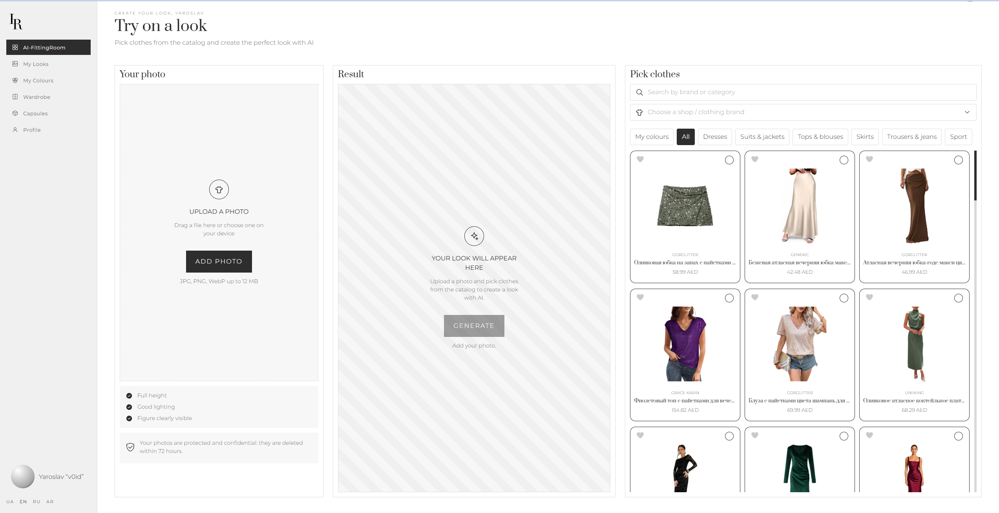
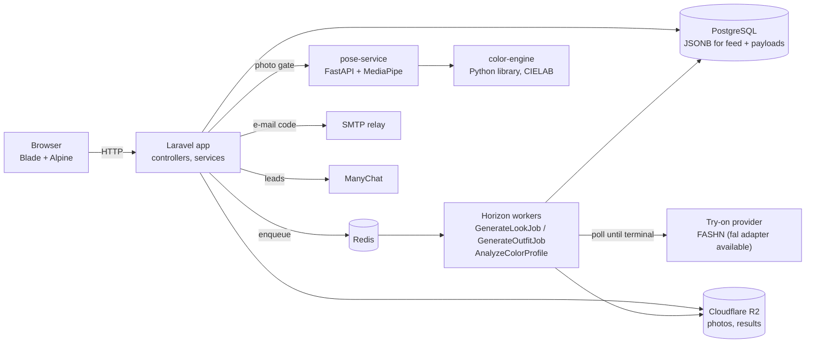

# Atelier Fit — AI virtual fitting room

[](https://github.com/HChinasky/atelier-fit/actions/workflows/ci.yml)

Atelier Fit lets a shopper upload a photo of themselves, pick garments from a catalogue imported from a partner feed, and get an AI-generated image of themselves wearing them. A member area adds a credit wallet, saved looks, a wardrobe, outfit capsules and an experimental seasonal colour-type analysis. It was built for a stylist's site in the UAE market and is a Laravel backend with Blade/Alpine pages and two small Python services.

<!-- Screenshot: add one at docs/screenshot.png and uncomment the next line.

-->

**Status.** A working application with a full test suite, built almost entirely with Claude Code under the rules in [`CLAUDE.md`](CLAUDE.md). Payments are not connected (plan buttons are deliberately inert), and the colour classifier is an unvalidated draft — see [Limitations](#limitations).

## Architecture



| Part | Where | Role |
|---|---|---|
| Laravel app | `app/`, `routes/`, `resources/views/` | HTTP, auth (e-mail code, Google, Apple), credits, catalogue, member area |
| Queue workers | `app/Jobs/`, `config/horizon.php` | Try-on generation, outfit chaining, colour analysis, feed import, analytics |
| Try-on provider | `app/Services/Fashn/`, `app/Services/Fal/` | One `TryOnProvider` interface, two adapters selected by `TRYON_DRIVER` |
| `pose-service` | `pose-service/` | FastAPI detector: person count, landmarks, crop box; also hosts `/color-analysis` |
| `color-engine` | `services/color-engine/` | Python library: face zones → CIELAB → 12-season scores. Never imported by Laravel, only reached over HTTP through `pose-service` |
| Storage | Cloudflare R2 (S3 driver) | Uploaded photos and results; an hourly app-side sweep enforces the 72 h retention |

## Running it

Requirements: Docker, PHP 8.2 + Composer on the host (or run everything in the container), Python 3.10–3.12 for the two Python parts.

```bash
cp .env.example .env                  # then fill the blanks; everything has a safe default
composer install
docker compose up -d                  # app (Sail), PostgreSQL 18, Redis, Horizon
docker compose exec laravel.test php artisan key:generate
docker compose exec laravel.test php artisan migrate
bash scripts/fetch-vendor-assets.sh   # self-hosted fonts / Alpine / Dropzone (not committed)
```

App on <http://localhost>, Horizon on `/horizon`. Feature flags in `.env` are all **off** by default; for a first look set `FEATURE_MEMBERSHIP=true`. On Windows/Git Bash call `docker compose` directly rather than the Sail wrapper. Horizon needs `ext-pcntl`, so run it inside the Linux container.

Seed some products without any partner account: `php artisan feed:seed-local` (sample feed with placeholder images in `public/dev-catalog/`).

Real try-on generation needs a provider key (`FASHN_API_KEY`, or `FAL_KEY` with `TRYON_DRIVER=fal`). Without one, the pages work but generation fails cleanly into the `failed` state with a refund.

### pose-service (photo gate and colour analysis)

```bash
cd pose-service
python -m venv .venv && source .venv/bin/activate   # Windows: .venv\Scripts\activate
pip install -r requirements.txt                     # also installs ../services/color-engine
python download_model.py                            # MediaPipe pose model
python -m uvicorn app.main:app --reload --host 127.0.0.1 --port 8000
```

Laravel reaches it through `POSE_SERVICE_URL` (from the Sail container: `http://host.docker.internal:8000`). With `POSE_DRIVER=null` the photo gate is skipped. Full contract and deployment notes: [`pose-service/README.md`](pose-service/README.md).

### color-engine (seasonal colour analysis)

```bash
cd services/color-engine
uv venv --python 3.10 && uv pip install -e ".[dev]"
python scripts/fetch_models.py                      # ~20 MB of MediaPipe models, sha256-pinned
```

Start `pose-service` with `COLOR_ENGINE_ENABLED=true` (and, locally, `COLOR_ENGINE_WHITE_BALANCE_ENABLED=true`), then set `COLOR_ANALYSIS_ENABLED=true` in Laravel. Design, thresholds and the honest list of what is a stub: [`services/color-engine/README.md`](services/color-engine/README.md).

## Tests

```bash
docker compose exec laravel.test php vendor/bin/pest            # PHP suite (real PostgreSQL, external calls faked)
(cd pose-service && python -m pytest)                           # detector service
(cd services/color-engine && python -m pytest)                  # colour engine
```

The PHP suite is about 1,500 test runs (Pest cases plus dataset rows) against a real PostgreSQL database rather than SQLite, so JSONB, upserts and partial indexes are exercised. FASHN, fal, ManyChat, R2 and mail are always faked. CI (`.github/workflows/ci.yml`) runs the PHP suite on every push and pull request.

## Design decisions

**Credit ledger, not a balance column** — `app/Services/Credits/CreditService.php`. A member's balance is the sum of `credit_transactions.delta`; nothing stores it. A spend takes a row lock on the user (`lockForUpdate`) and checks the balance inside the critical section, so concurrent requests cannot overspend. A refund is idempotent through a unique index on `(generation_id, reason)`, and a retried failure hook simply hits the constraint. A welcome grant is keyed by an HMAC of the normalised e-mail in `welcome_grants`, so it is given once per address even after the account is deleted, without keeping a readable address.

**Signed status URLs** — `routes/api.php`, `app/Http/Controllers/Api/GenerationStatusController.php`. A result is an image of a person, so polling by bare id would let anyone enumerate other people's results. Starting a generation returns a temporary signed URL whose HMAC covers that exact id; the `signed` middleware rejects anything else before the controller runs. Chosen over session binding because the API is stateless.

**Feature flags that return 404** — `config/features.php`, middleware `feature:<name>`. Every flag is off by default, so a deploy never opens unfinished work, and a disabled feature is an ordinary 404 rather than a redirect that reveals the route. The start page is deliberately outside the group and the controller decides, so it always answers. The status route is also outside the flag so an already-started generation can finish.

**Generation is asynchronous only** — `app/Jobs/GenerateLookJob.php`, `GenerateOutfitJob.php`. The HTTP endpoint validates, spends, enqueues and returns the signed URL; waiting on the provider happens inside the job (polling until a terminal status), never in a request. Failures end in `failed`, a log entry, a refund and a clear state for the user.

**Outfit chaining** — `GenerateOutfitJob`. The provider dresses one garment per call, so a set is a chain: the result of step N becomes the person image of step N+1, with pose and aspect ratio pinned on every call so layers do not drift.

**Photo gate before budget** — `app/Http/Controllers/Api/GenerationController.php`. The order is lead ownership → photo preprocessing (person count, crop, lighting) → budget cap → spend. An unsuitable photo is rejected immediately with a localised hint and never costs a provider call or a credit. The preprocessor fails open when its service is down, by configuration.

**Privacy stated honestly** — photos go to a third-party provider; the copy says "within 72 hours" in every language, never "immediately", and an hourly sweep enforces it because the storage lifecycle rule proved unreliable.

**Colour palette enforced by a test** — the UI is exactly four colours plus transparency; `AppearanceTest` fails on any new shade.

## How I work with Claude Code

This project was written with Claude Code, and the working agreement lives in [`CLAUDE.md`](CLAUDE.md), which the agent reads before every task. The points that matter:

- **Iron constraints.** Decisions that must not be "improved" silently (provider choice, async-only generation, honest privacy wording, lead timing) are written down as rules, with an instruction to ask rather than choose when a task conflicts with one.
- **Definition of done.** A task is not done until tests exist and pass; every bug fix carries a test that reproduces it; data comes from factories; external services are always faked.
- **Delivery loop.** Each change is implemented in a git worktree cut from `origin/main` (the working checkout often carries unrelated work in progress), the relevant tests and then the full suite run, the diff is shown, and only after an explicit go-ahead does it go through a pull request, merge and deploy. Nothing is committed or pushed without that command.
- **Checking the agent's claims.** Reported results are re-measured rather than trusted: for example a colour-engine fix was only accepted after a rewritten fixture showed the old code scoring 8.3 and the fixed code 50.4 on the same input, since a first test had passed without the fix. A confident statement that a result "looked wrong" was retracted once the measured values showed otherwise.
- **State the limits.** A partial deliverable names what it does not cover in the same reply.
- **Repo-level skill.** `.claude/skills/translate/SKILL.md` encodes the i18n procedure (keys in four languages, parity tests, RTL rules) so every session follows it.

## Known debt / what I'd refactor next

Honest list, roughly by how visible it is to a reviewer:

- **Fat controllers and long methods.** `Api/GenerationController::store` and `Api/OutfitGenerationController::store` are 160–170 lines each and repeat the same gate sequence (ownership, photo, analytics, budget). They should become one `StartGeneration` action. `MembershipController` (~490 lines) and `Admin/ColorAnalysisController` (~690 lines) want splitting by feature.
- **Duplicated job logic.** `GenerateLookJob::handle` and `GenerateOutfitJob::handle` (100+ lines each) share the polling, refund and failure handling; extract a shared runner.
- **Other long methods.** `DeleteUserDataCommand::handle`, `OtpService::send`, and `AppServiceProvider::register` (a long list of bindings).
- **Authorization is by hand.** Ownership checks are `abort_unless(... user_id === ...)` scattered across controllers. Eloquent policies would centralise them.
- **No lazy-loading guard.** `Model::shouldBeStrict()` is not enabled in development, so an N+1 would not announce itself.
- **Stuck generations do not refund.** A generation stranded in `processing` (worker crash) does not return the member's credit. A scheduled sweep is designed but not built.
- **Docs and code drift.** `CLAUDE.md` names FASHN as the only engine, while the container binding defaults to the fal adapter when `TRYON_DRIVER` is unset (`.env.example` sets it to `fashn`).
- **Front end without a build step.** Large Blade templates carry inline CSS and Alpine; it is deliberate, but they would not scale to a larger team.

## Limitations

- **Payments are not connected.** Plans and prices are shown, and the buttons are inert with a "coming soon" note. The credit ledger and gating work; nothing charges money.
- **The colour classifier is a draft.** Every anchor, weight and prototype in `classifier.json` was reasoned from the 12-season system, not fitted to labelled photographs, because no labelled set exists. Results carry `classifier.draft: true` and the UI says so. Do not read its output as a stylist's verdict.
- **The palette data is approximate.** Season palettes were read from a screenshot of a stylist's chart, so each colour is close to, not identical to, the printed swatch. The "avoid" group is generated, not curated.
- **Legal texts are placeholders.** `docs/legal/*.md` are generic sample documents, not legal advice.
- **Sample catalogue only.** Product photos in `public/dev-catalog/` are generated placeholders; real catalogue import needs a partner feed.
- **Not load tested.** Throughput limits come from configured rate limits and the provider, not from measurement.
- **Some UI copy is machine-assisted.** Russian and Arabic strings were generated and want a native speaker's read, Arabic season names especially.
